<div align="center">

# OpenClaude Desktop

### A 1:1 open-source recreation of Claude Desktop, running the AI you choose

**English** · [简体中文](README.zh-CN.md)


[](LICENSE)

<br>

<picture>
  <source media="(prefers-color-scheme: dark)" srcset="docs/images/session-dark-en.png">
  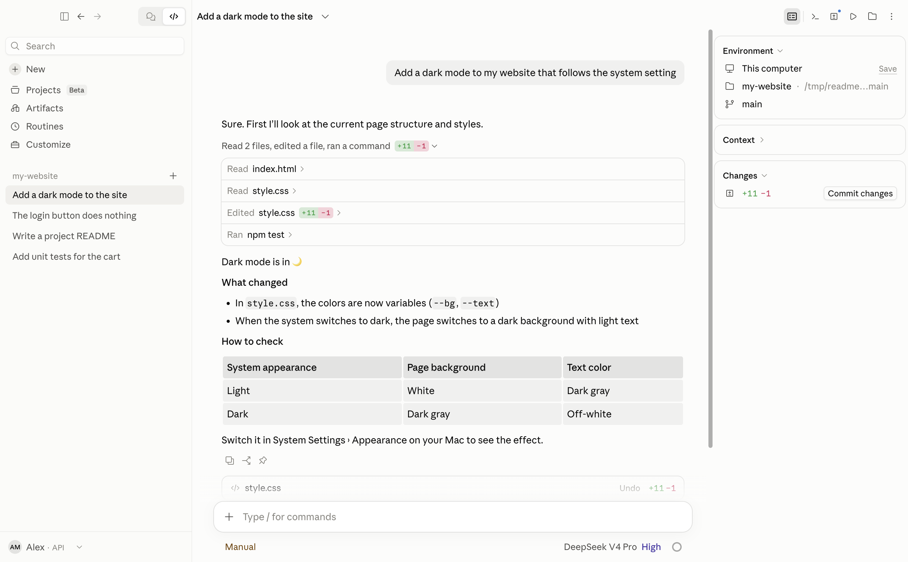
</picture>

</div>

<br>

## What it is

The official Claude Desktop Code interface, recreated 1:1. Not a look-alike: the components are sliced out of the official app by generators and run as they are, with a thin host layer that lets them drive other AI cores.

- **Same UI, same behavior**: sidebar, composer and environment bar, transcript (working line, tool rows, diffs), task list and next-step box, session rail with the Context breakdown, settings, menus and shortcuts.
- **Same features**: permission modes, plans, side chats, routines, dynamic workflows, terminal, preview, files and changes panes, MCP, skills, plugins and hooks.
- **Your AI**: DeepSeek Harness (built in), Codex, Kimi, Qwen, MiniMax, Gemini, OpenCode, ZCode, MiMo, or any OpenAI-compatible endpoint. Per-model display names, context windows and image input.
- **No Claude account**: pay your provider directly. Settings and history stay on your Mac.

## Versions

This branch (`ui-next`) is the **new UI**, recreated from Claude Desktop 2.42304.0. The `main` branch keeps both versions side by side: `new-2.42304.0/` and the old UI in `old-2.31226.0/` (recreated from Claude Desktop 2.31226.0).

## Screenshots

<table>
  <tr>
    <td width="50%">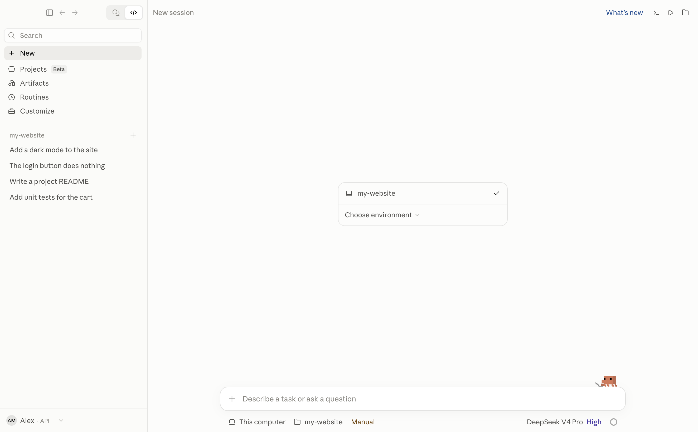</td>
    <td width="50%">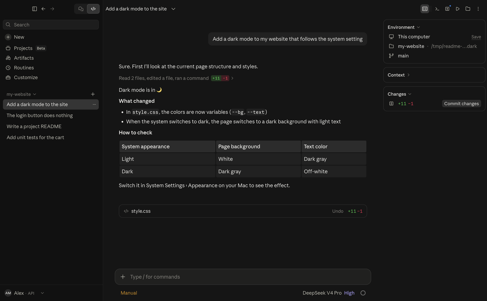</td>
  </tr>
  <tr>
    <td width="50%"></td>
    <td width="50%">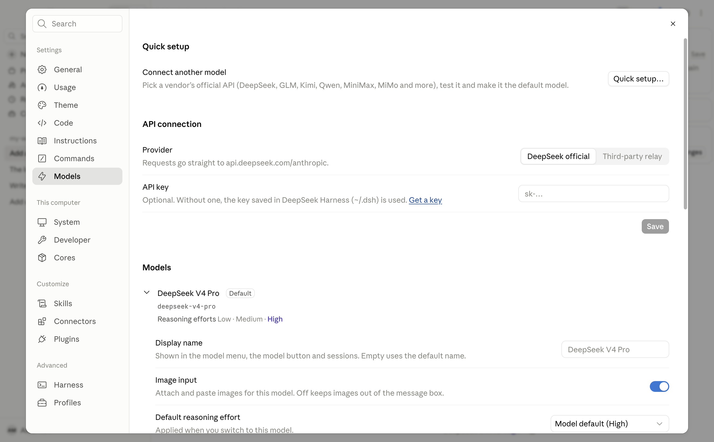</td>
  </tr>
</table>

## Core features

<table>
  <tr>
    <td width="50%">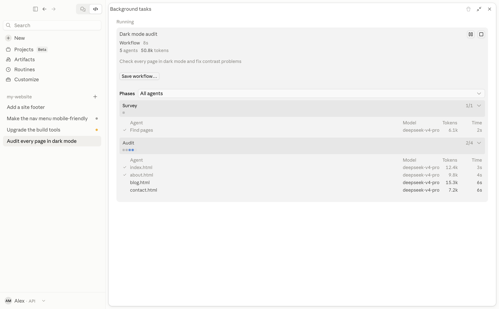<br><b>Dynamic Workflow</b>: phases and agents, live in Background tasks</td>
    <td width="50%">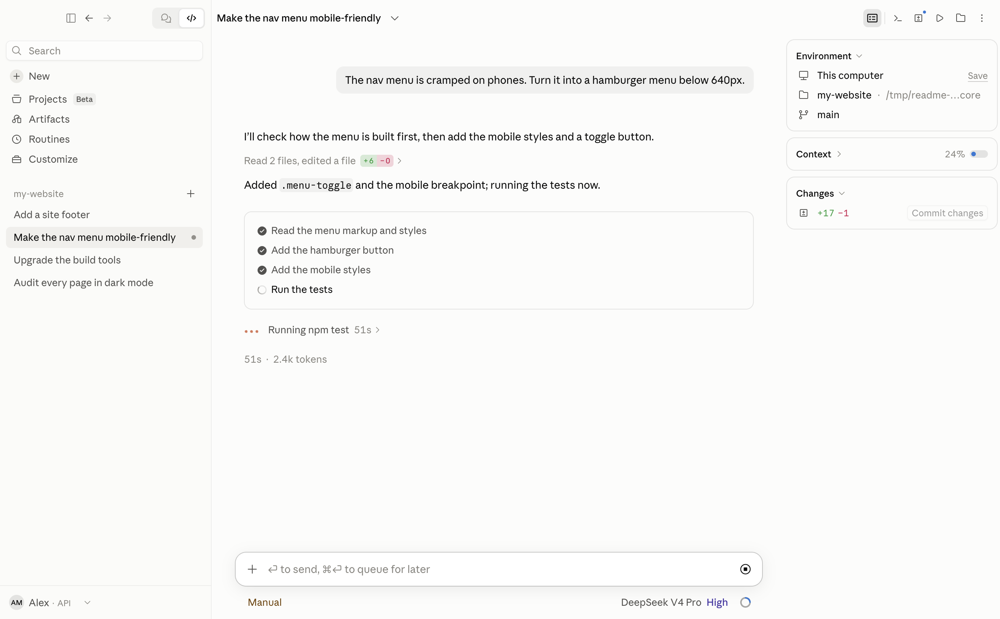<br><b>Task list</b> and the working line with the running tool</td>
  </tr>
  <tr>
    <td width="50%">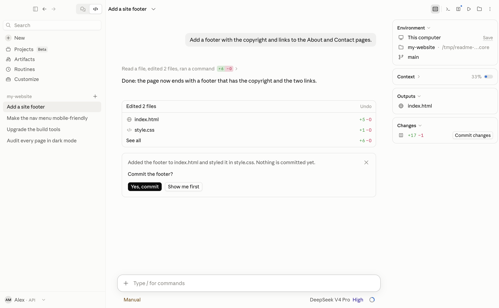<br><b>Next step</b> box at the end of a turn</td>
    <td width="50%">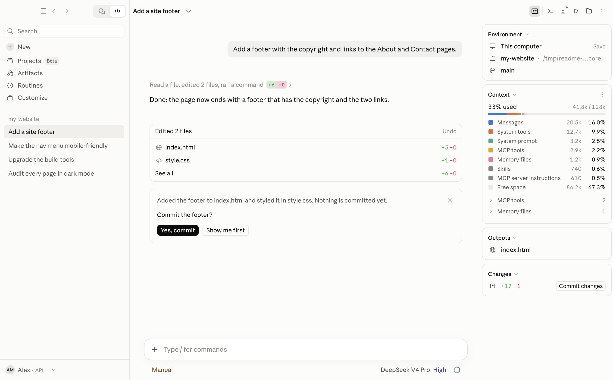<br><b>Context</b> breakdown in the session rail</td>
  </tr>
  <tr>
    <td width="50%">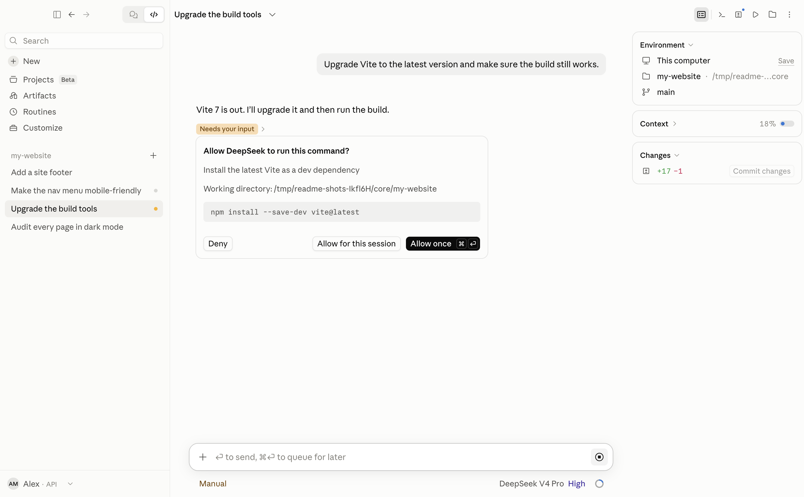<br><b>Approval</b> card for a command</td>
    <td width="50%">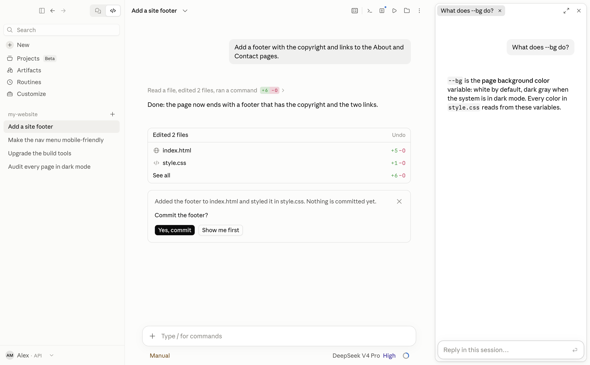<br><b>/btw</b> side chat next to the session</td>
  </tr>
  <tr>
    <td width="50%">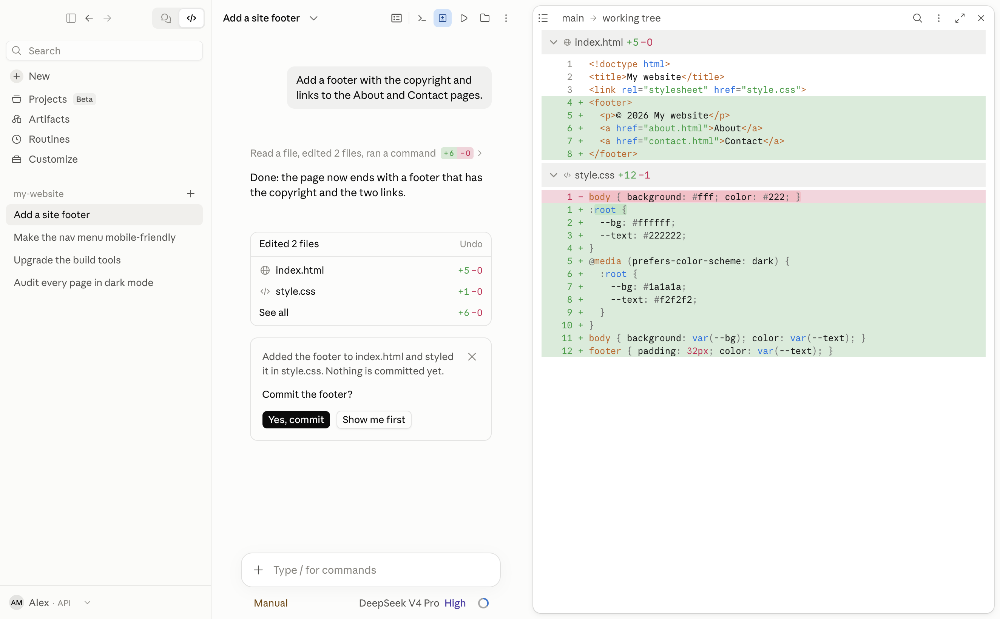<br><b>Changes</b> pane with the session diff</td>
    <td width="50%">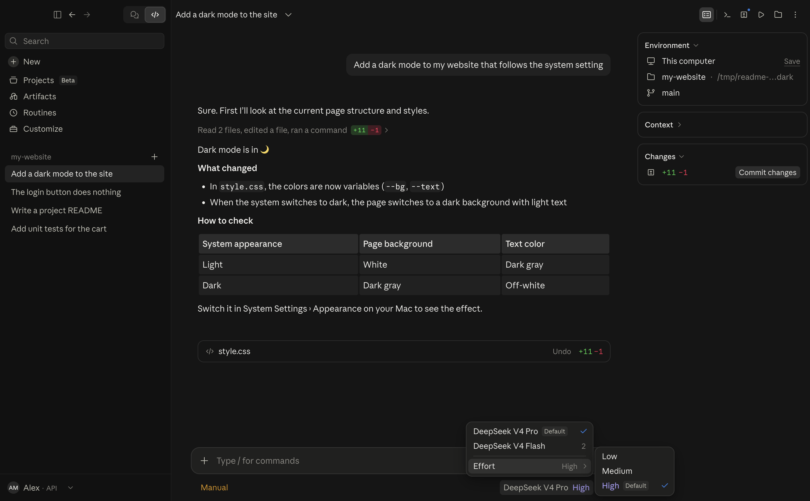<br>Model menu with the <b>Effort</b> submenu (dark)</td>
  </tr>
</table>

## Install

You need a Mac with Apple silicon, [Node.js](https://nodejs.org) 22.19 or newer (`brew install node`) and an API key for your provider ([DeepSeek](https://platform.deepseek.com/api_keys) is the default).

```bash
git clone https://github.com/oleyyu/OpenClaudeDesktop.git
cd OpenClaudeDesktop/harness && npm install
cd ../app && npm install
npm run package
```

The app lands in `OpenClaudeDesktop/releases/OpenClaude Desktop-darwin-arm64/`; drag it into Applications. To try it without packaging, run `npm run build && npm start` in `app/`.

> Building needs the `reference/` assets (fonts, icons), which aren't in this repository. In mainland China, `npm config set registry https://registry.npmmirror.com` speeds up `npm install`.

On first launch, pick a core and connect a model (an official API key, or any endpoint's base URL and key). Change it later in **Settings › Models**.

## FAQ

- **The core never connects**: usually Node.js is older than 22.19. Run `node -v`, then `brew upgrade node`.
- **What does it cost?** The app is free; you pay your provider for what you use (Settings › Usage).
- **Where is my data?** On your Mac: `~/Library/Application Support/OpenClaude Desktop/` and, for DeepSeek, `~/.dsh/`. Only the conversation goes to the provider you chose.

## For contributors

`app/` is the Electron + React app (official components in `app/src/generated/`, one generator per area in `app/scripts/extract-*.mjs`); `harness/` connects the cores. Tests: `npm test` in `app/` and in `harness/`.

## License

[MIT](LICENSE).

> **Disclaimer**: OpenClaude Desktop is an unofficial community project, not affiliated with or endorsed by Anthropic. "Claude" is a trademark of Anthropic, used only to describe the interface.
