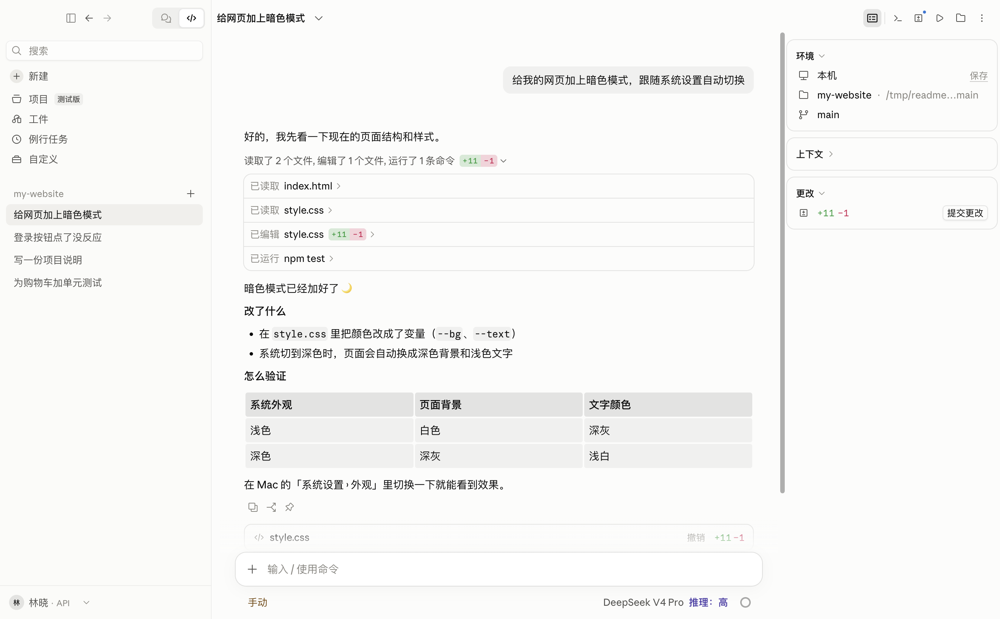
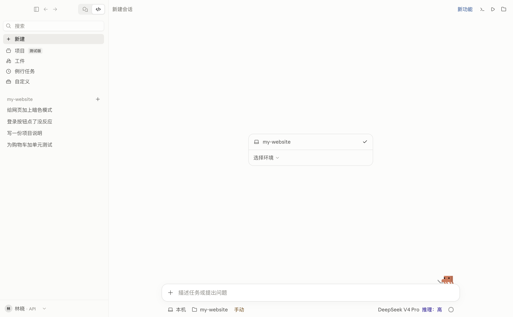
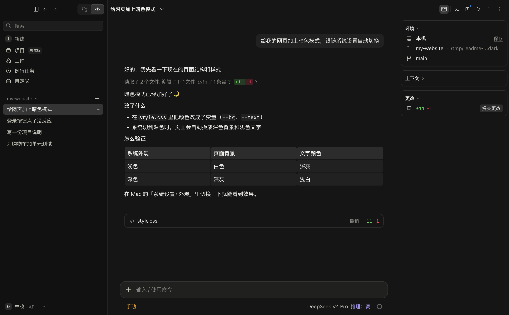
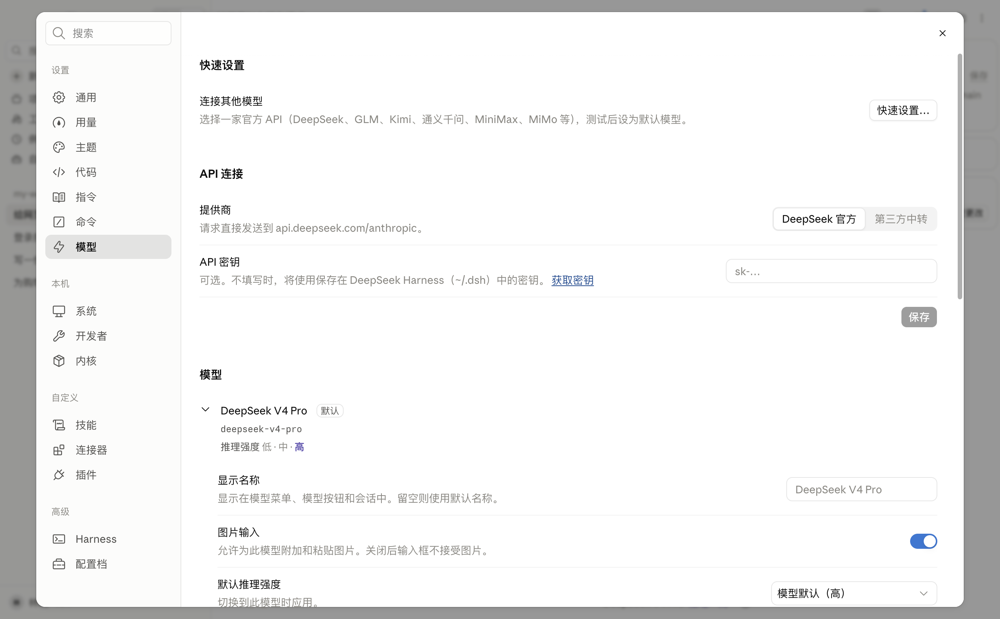

<div align="center">

# OpenClaude Desktop

### 1:1 复刻 Claude Desktop 的开源版，跑你自己选的 AI

[English](README.md) · **简体中文**


[](LICENSE)

<br>

<picture>
  <source media="(prefers-color-scheme: dark)" srcset="docs/images/session-dark.png">
  
</picture>

</div>

<br>

## 这是什么

1:1 复刻官方 Claude Desktop 的 Code 界面。不是仿制：界面组件由生成器从官方应用里原样切出、直接运行，宿主只加一层适配，让它们能驱动其他 AI 内核。

- **界面和交互一致**：侧栏、输入框与环境栏、对话区（加载行、工具行、diff）、任务清单与下一步框、会话右栏与 Context 明细、设置、菜单和快捷键。
- **功能一致**：权限模式、计划、侧边对话、定时任务、动态工作流、终端、预览、文件与改动面板、MCP、Skills、插件、Hooks。
- **AI 你来选**：内置 DeepSeek Harness，也支持 Codex、Kimi、Qwen、MiniMax、Gemini、OpenCode、ZCode、MiMo，或任何 OpenAI 兼容接口。每个模型可以单独设显示名、上下文窗口和图片输入。
- **不需要 Claude 账号**：直接向你选的服务商付费，设置和记录都留在你的 Mac 上。

## 版本

这个分支（`ui-next`）是**新界面**，复刻自 Claude Desktop 2.42304.0。`main` 分支同时保留两个版本：`new-2.42304.0/` 和旧界面 `old-2.31226.0/`（复刻自 Claude Desktop 2.31226.0）。

## 截图

<table>
  <tr>
    <td width="50%"></td>
    <td width="50%"></td>
  </tr>
  <tr>
    <td width="50%"></td>
    <td width="50%"></td>
  </tr>
</table>

## 安装

需要 Apple 芯片的 Mac、[Node.js](https://nodejs.org) 22.19 或更新版本（`brew install node`），以及服务商的 API key（默认 [DeepSeek](https://platform.deepseek.com/api_keys)）。

```bash
git clone https://github.com/oleyyu/OpenClaudeDesktop.git
cd OpenClaudeDesktop/harness && npm install
cd ../app && npm install
npm run package
```

打包好的应用在 `OpenClaudeDesktop/releases/OpenClaude Desktop-darwin-arm64/`，拖进「应用程序」即可。不打包直接试用：在 `app/` 里运行 `npm run build && npm start`。

> 打包需要 `reference/` 里的界面资源（字体、图标），不在本仓库中。国内网络可先运行 `npm config set registry https://registry.npmmirror.com` 加快 `npm install`。

首次启动时选择内核、连接模型（官方 API key，或任意接口的地址和 key），之后可在「设置 › 模型」里修改。

## 常见问题

- **内核一直连不上**：多半是 Node.js 低于 22.19。运行 `node -v` 检查，再 `brew upgrade node`。
- **要花多少钱？** 应用免费，按用量向服务商付费（设置 › 用量）。
- **数据存在哪？** 都在你的 Mac 上：`~/Library/Application Support/OpenClaude Desktop/`，DeepSeek 的对话在 `~/.dsh/`。只有对话内容会发给你选的服务商。

## 参与开发

`app/` 是 Electron + React 应用（官方组件在 `app/src/generated/`，每块区域一个生成器 `app/scripts/extract-*.mjs`）；`harness/` 负责连接各内核。测试：分别在 `app/` 和 `harness/` 里运行 `npm test`。

## 许可证

[MIT](LICENSE)。

> **声明**：OpenClaude Desktop 是非官方社区项目，与 Anthropic 无关联，也未获其认可。“Claude” 是 Anthropic 的商标，这里仅用于描述界面风格。
